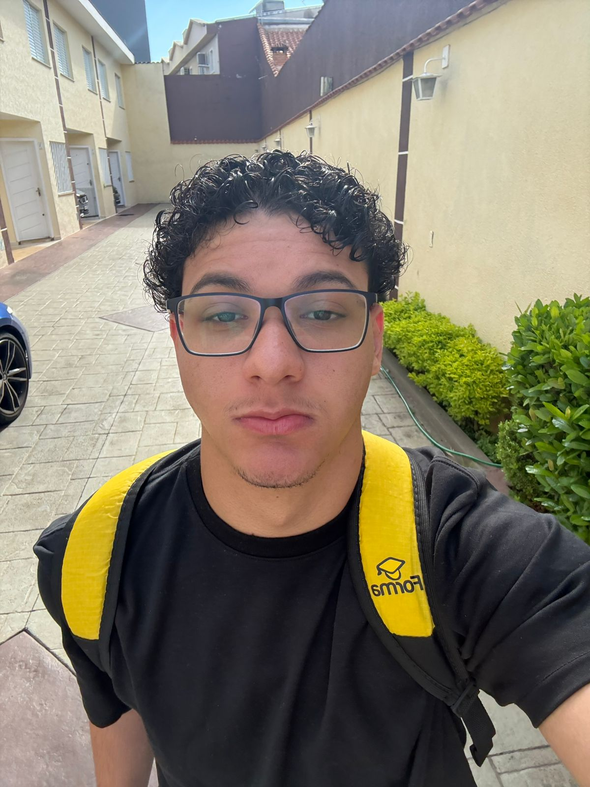

  

  <h1>Felipe Iazzette Gonçalez</h1>

  

    Engenharia de Software · Desenvolvimento Web · Tecnologia da Informação
  

  

    <a href="https://github.com/Iazzette">GitHub</a> ·
    <a href="https://www.linkedin.com/in/felipe-goncalez-0644502b5/">LinkedIn</a> ·
    <a href="https://www.instagram.com/fe_iazzette/">Instagram</a>
  

---

## Sobre este portfólio

Criei este espaço para reunir um pouco da minha trajetória em tecnologia, meus projetos e os conhecimentos que venho desenvolvendo.

Sou técnico em Tecnologia da Informação pelo **Senac Nações Unidas** e estudante de **Engenharia de Software na Universidade São Judas Tadeu**, atualmente no **2º semestre**. Tenho experiência com desenvolvimento de sistemas, sites, integrações e ferramentas usadas em processos reais de uma empresa.

## Projetos em destaque

- **Lika Manager:** CRM e sistema de gestão para acompanhar leads e processos comerciais e operacionais.
- **Site institucional da Lika:** desenvolvimento e manutenção do site, com captação de leads e integração com WhatsApp.
- **Aplicativo de organização empresarial:** projeto próprio em desenvolvimento.
- **Site de avaliação de filmes e livros:** aplicação web para organizar e avaliar filmes e livros.
- **Robô sumô:** projeto de extensão de 120 horas com robótica, montagem, integração de componentes e testes.
- **Grua eletromagnética:** projeto acadêmico de automação e experimentação.

## Tecnologias

Neste site, usei **HTML, CSS e JavaScript**. Nos meus estudos e projetos, também trabalho com **React, TypeScript, Node.js, APIs REST, MySQL, SQLite, Python, Java, C++ e Ollama**.

## Formação e reconhecimento

- **Engenharia de Software** — Universidade São Judas Tadeu, em andamento.
- **Técnico em Tecnologia da Informação** — Senac Nações Unidas, concluído em 2025.
- **Medalha de Prata** — Olimpíada Nacional de Nanotecnologia (ONANO 2025).

## Contato

- **E-mail:** [felipe.igoncalez@gmail.com](mailto:felipe.igoncalez@gmail.com)
- **LinkedIn:** [felipe-goncalez](https://www.linkedin.com/in/felipe-goncalez-0644502b5/)
- **Instagram:** [@fe_iazzette](https://www.instagram.com/fe_iazzette/)
- **GitHub:** [@Iazzette](https://github.com/Iazzette)
